<!-- course-site-backlink:start -->
[Этот урок на сайте](https://AntonC9018.github.io/uniCourse_csharp/ru/labs/basic/array-practice/)
<!-- course-site-backlink:end -->
# Практика по массивам

> Эта лаба добавлена для практики. Цель — научиться решать подобные задачи.
> Выполнять все задания необязательно: используйте их для самообучения.

## Синтаксис массивов

Массив хранит фиксированное число элементов одного типа.
Создаётся он через `new` с указанием длины, а элементы нумеруются с нуля:

```csharp
int[] counts = new int[5];
counts[0] = 3;
int first = counts[0];
```

Длину массива можно узнать через `.Length`.
Массивы можно создавать для любых типов, включая типы из предыдущих работ:

```csharp
Book[] books = new Book[3];
books[1] = new Book
{
    title = "Атлас",
};
books[1].title = "Словарь";
```

## Практика

Используйте понятия из предыдущих работ, чтобы смоделировать каждую задачу и написать процедурные функции.
Для хранения фиксированного числа элементов используйте массивы.
Не используйте циклы.
Если в условии не сказано иное, считайте, что переданные индексы допустимы, а имеющихся количеств достаточно.
Все позиции заданы; искать нужные переменные не нужно.
У первых трёх задач есть возможные решения.
Остальные задачи решите самостоятельно.

### 1. Число из спичек

Цифры выкладывают из спичек в форме семисегментного индикатора.
Для цифр 0–9 нужно соответственно 6, 2, 5, 5, 4, 5, 6, 3, 7, 6 спичек.
Из спичек выложено число 208.
Переложите спички так, чтобы получилось 731.
Сколько спичек останется неиспользованными?
Напишите функцию, которая считает, сколько спичек нужно для любых трёх заданных цифр.

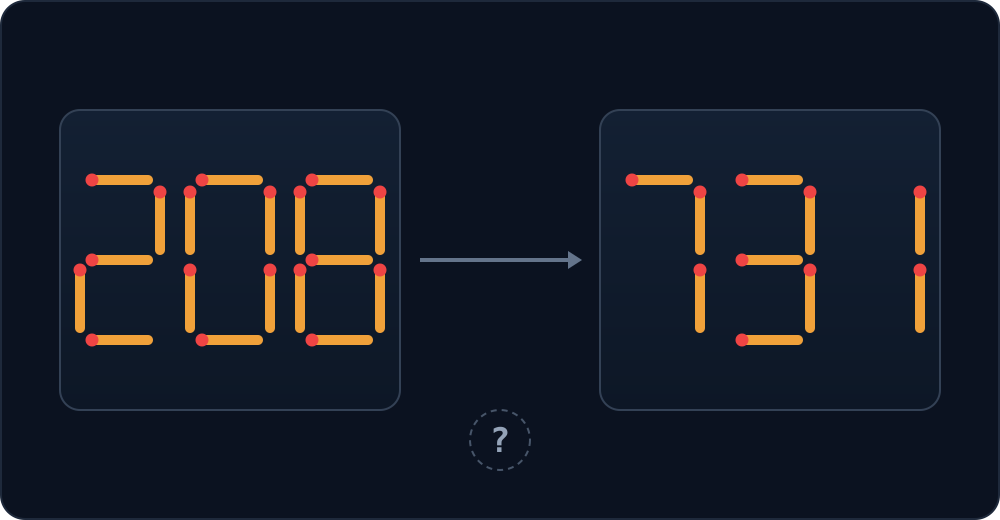

<details>
<summary>Возможное решение</summary>

Модель:

```csharp
class DigitConfig
{
    public int[] matchsticksPerDigit;
}

class DigitDisplay
{
    public int[] digits;
}
```

Программа:

```csharp
DigitConfig config = new()
{
    matchsticksPerDigit = [6, 2, 5, 5, 4, 5, 6, 3, 7, 6],
};
DigitDisplay original = new()
{
    digits = [2, 0, 8],
};
DigitDisplay replacement = new()
{
    digits = [7, 3, 1],
};
int available = CountMatchsticks(config, original);
int needed = CountMatchsticks(config, replacement);
Console.WriteLine(available - needed);

static int CountMatchsticks(DigitConfig config, DigitDisplay display)
{
    return config.matchsticksPerDigit[display.digits[0]]
        + config.matchsticksPerDigit[display.digits[1]]
        + config.matchsticksPerDigit[display.digits[2]];
}
```

Печатает `8`.
Для цифр числа 208 нужно `5 + 6 + 7 = 18` спичек, а для цифр числа 731 — `3 + 5 + 2 = 10`.
Каждая цифра выбирает нужное количество спичек из таблицы.
Для исходного числа `display.digits[0]` даёт `2`, а `config.matchsticksPerDigit[2]` даёт `5`.

</details>

### 2. Компиляция исходного кода

У исходного кода есть число строк, а у машинного кода — число инструкций.
Есть три уровня оптимизации: без оптимизации, базовая и полная.
Отношение числа машинных инструкций к числу строк зависит от компилятора и уровня оптимизации.
В этой упрощённой модели для MSVC коэффициенты равны 2.5, 1.5 и 1.25, а для GCC — 3, 1.75 и 1.
Скомпилируйте 101 строку обоими компиляторами с полной оптимизацией, оставляя только целые инструкции.

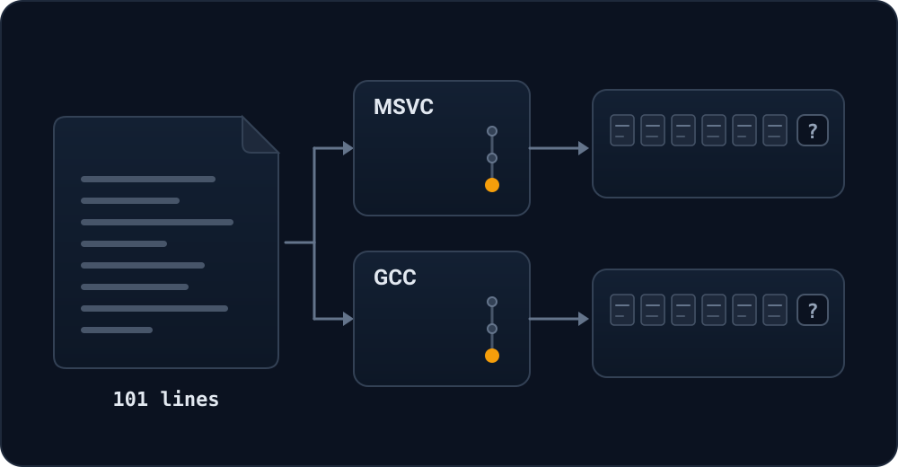

<details>
<summary>Возможное решение</summary>

Модель:

```csharp
enum OptimizationLevel
{
    None,
    Basic,
    Full,
}

class SourceCode
{
    public int lineCount;
}

class MachineCode
{
    public int instructionCount;
}

class Compiler
{
    public double[] instructionsPerLine;
}
```

Программа:

```csharp
Compiler msvc = new()
{
    instructionsPerLine = [2.5, 1.5, 1.25],
};
Compiler gcc = new()
{
    instructionsPerLine = [3.0, 1.75, 1.0],
};
SourceCode source = new()
{
    lineCount = 101,
};
MachineCode msvcResult = Compile(msvc, source, OptimizationLevel.Full);
MachineCode gccResult = Compile(gcc, source, OptimizationLevel.Full);
Console.WriteLine(msvcResult.instructionCount);
Console.WriteLine(gccResult.instructionCount);

static MachineCode Compile(Compiler compiler, SourceCode source, OptimizationLevel level)
{
    double coefficient = compiler.instructionsPerLine[(int)level];
    double estimate = source.lineCount * coefficient;
    return new MachineCode
    {
        instructionCount = (int)estimate,
    };
}
```

Программа выводит `126` и `101`.
Для MSVC уровень `Full` выбирает коэффициент `1.25`; умножение даёт `126.25`.
Преобразование в `int` отбрасывает дробную часть.
Для GCC тот же уровень выбирает `1`, поэтому получается `101` инструкция.
Приведение перечисления к `int` даёт индекс коэффициента.
В выражении `source.lineCount * coefficient` число строк неявно превращается в `double`,
но само поле `source.lineCount` остаётся `int`.

</details>

### 3. Отсеки холодильника

В холодильнике три ячейки, в каждой стоит одна бутылка молока.
В бутылках 100 мл, 300 мл и 200 мл.
Налейте 120 мл из второй бутылки в пустую чашку.
Сообщите остаток в этой бутылке, содержимое чашки и количество молока в первой бутылке.

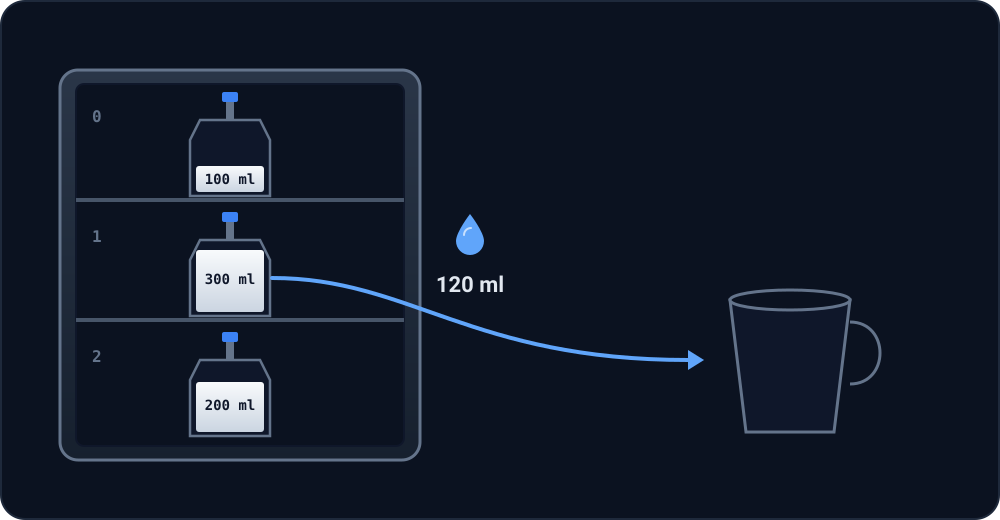

<details>
<summary>Возможное решение</summary>

Модель:

```csharp
class MilkBottle
{
    public int milkMl;
}

class Fridge
{
    public MilkBottle[] slots;
}

class Cup
{
    public int milkMl;
}
```

Программа:

```csharp
Fridge fridge = new()
{
    slots =
    [
        new MilkBottle
        {
            milkMl = 100,
        },
        new MilkBottle
        {
            milkMl = 300,
        },
        new MilkBottle
        {
            milkMl = 200,
        },
    ],
};
Cup cup = new();
PourMilk(fridge, 1, cup, 120);
Console.WriteLine(fridge.slots[1].milkMl);
Console.WriteLine(cup.milkMl);
Console.WriteLine(fridge.slots[0].milkMl);

static void PourMilk(Fridge fridge, int slotIndex, Cup cup, int amountMl)
{
    fridge.slots[slotIndex].milkMl -= amountMl;
    cup.milkMl += amountMl;
}
```

Программа выводит `180`, `120` и `100`.
`Fridge` и `Cup` — классы, поэтому функция меняет именно переданные объекты:
класс при передаче параметром не копируется.
Остальные бутылки не меняются.

</details>

### 4. Редактирование файла

Файл содержит пять строк, для каждой известно количество символов.
Добавьте символы в выбранную строку и поменяйте местами две выбранные строки.

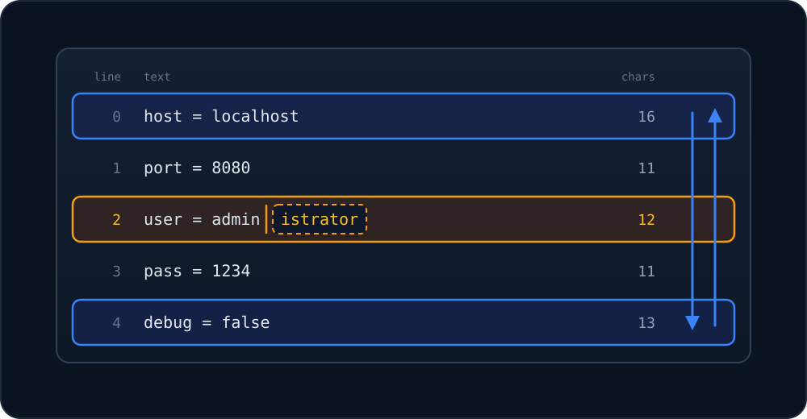

### 5. Стоимость проезда в автобусе

У автобусного перевозчика есть таблица тарифов для трёх категорий пассажиров.
Купите заданное количество билетов для выбранной категории и вычислите сдачу с переданной суммы.

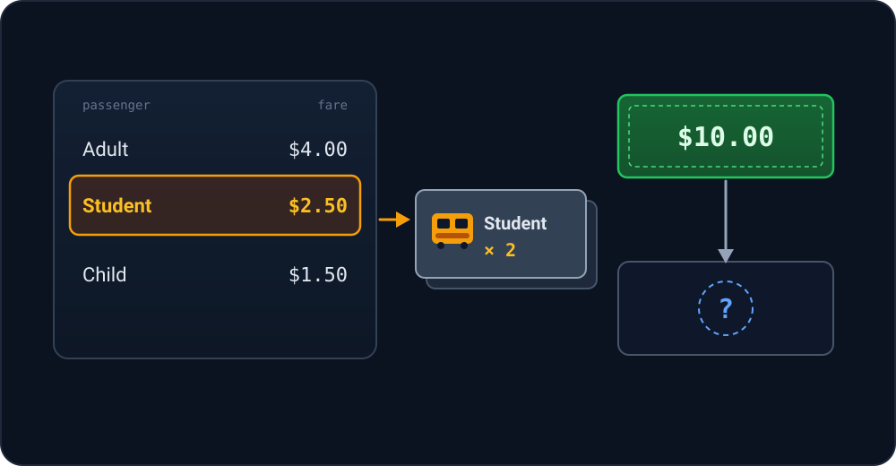

### 6. Выпечка в пекарне

У пекарни есть три рецепта, каждый из которых задаёт количество муки и сахара на одну партию выпечки.
Выберите рецепт и приготовьте заданное число партий, обновив запасы ингредиентов и число готовых партий.

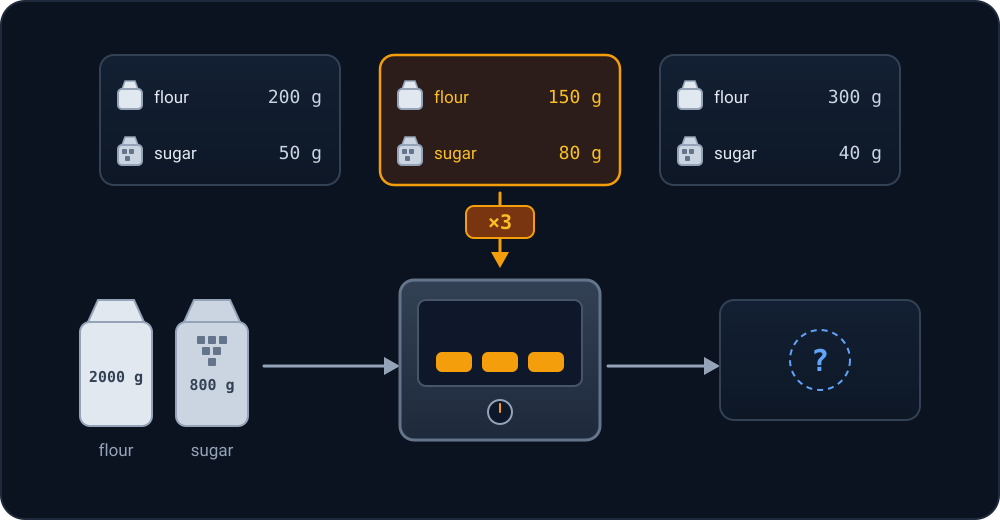

### 7. Ящики с шурупами

В шкафу четыре ящика с шурупами.
Переложите все шурупы из выбранного ящика в заданный пустой ящик, оставив исходный ящик пустым.

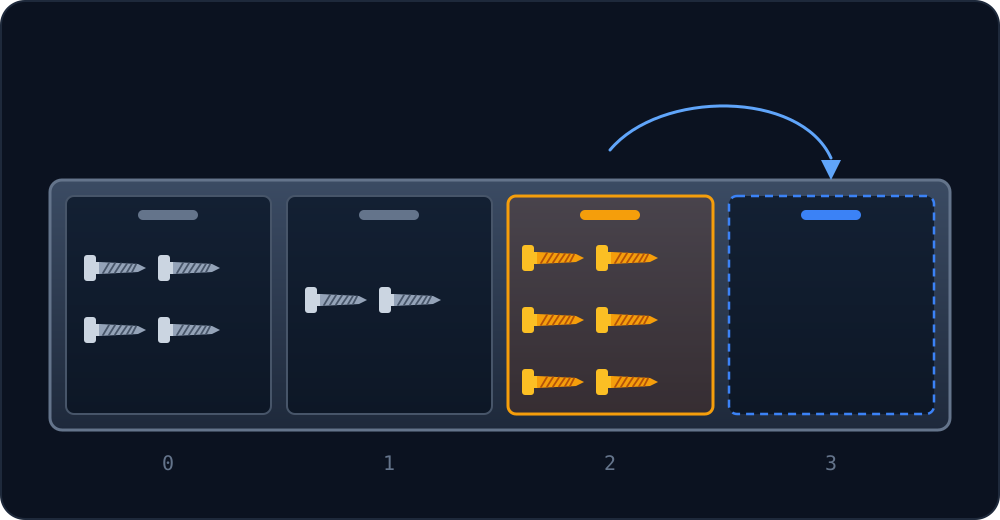

### 8. Вагоны поезда

В поезде есть три вагона, у каждого из которых есть вместимость и количество пассажиров.
Переместите пассажиров из одного выбранного вагона в другой и выведите число свободных мест в обоих вагонах.

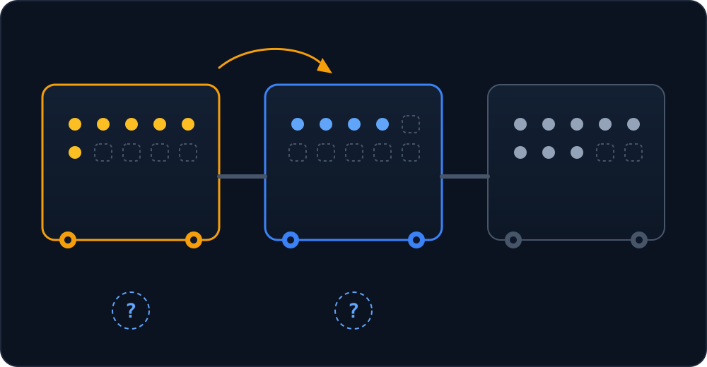

### 9. Очки по раундам

Игра записывает общее число очков игрока после каждого из пяти раундов.
Вычислите, сколько очков получено за выбранный раунд, кроме первого.
Исправьте записанный итог для заданного раунда и заново вычислите очки, полученные за этот раунд.

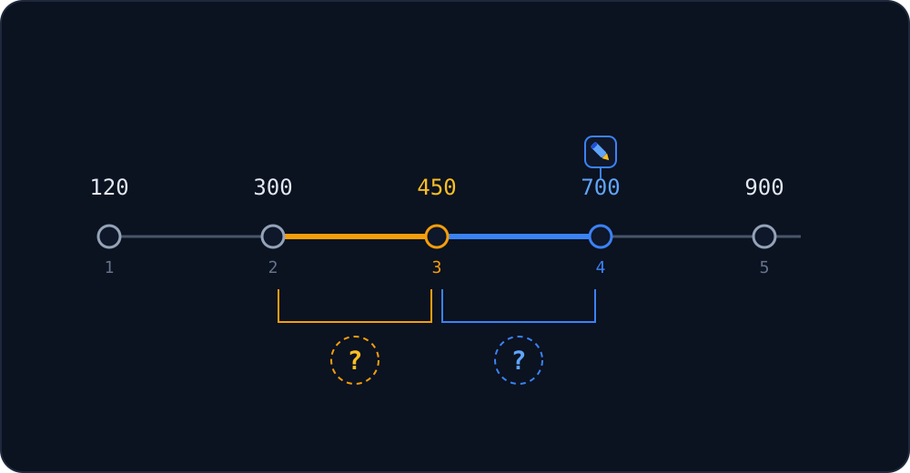

### 10. Мини-бар в гостинице

В гостиничном номере есть мини-бар с четырьмя ячейками для продуктов, а в гостинице — таблица цен.
Возьмите заданное количество продуктов из двух выбранных ячеек и обновите их запасы и счёт номера.

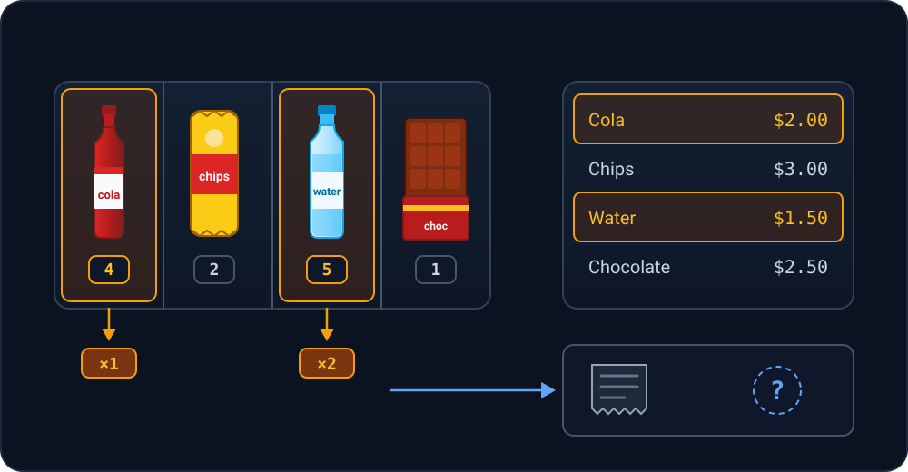

### 11. Воспроизведение плейлиста

В плейлисте пять треков с длительностью в секундах.
Плеер хранит номер текущего трека и время, прошедшее с его начала.
Перемотайте текущий трек на заданное время и сообщите, сколько секунд осталось.
Выберите другой трек и начните его с начала.

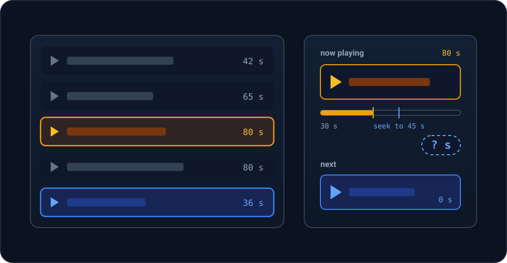

### 12. Смешивание коротких записей

В двух коротких записях по три звуковых отсчёта со значениями от -1 до 1.
Создайте новую запись, взяв в каждой позиции 25% значения из первой записи и 75% из второй.
Оставьте исходные записи без изменений.

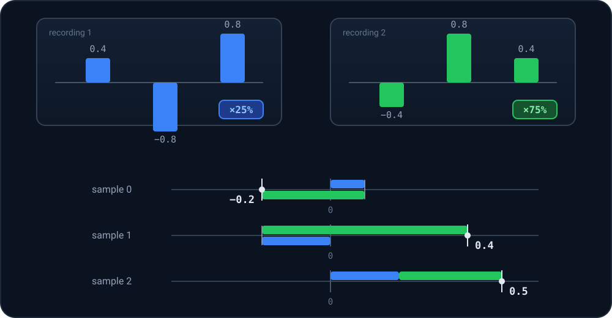

### 13. Места в театре

В театре три ряда по четыре места; каждое место хранит номер билета, а ноль означает свободное место.
Запишите заданный номер билета на заданное свободное место, затем перенесите его на другое заданное свободное место.
Для обоих мест даны ряд и номер места; искать места не нужно.
Оставьте исходное место свободным.

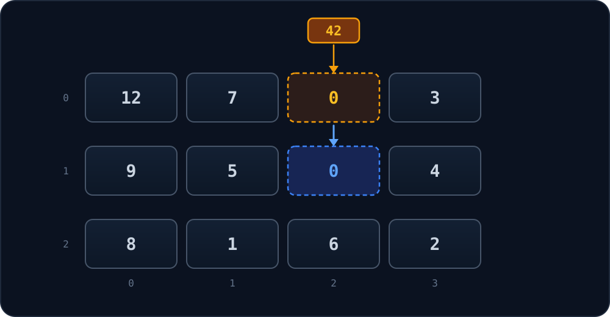

### 14. Маршрут робота-доставщика

Робот начинает движение из заданной позиции x/y, а карта доставки хранит четыре пункта с координатами x/y.
Посетите два пункта, выбранных по индексу, в заданном порядке.
Для каждого из двух перемещений сообщите изменение x и изменение y (вектор перемещения).
Также сообщите конечную позицию.

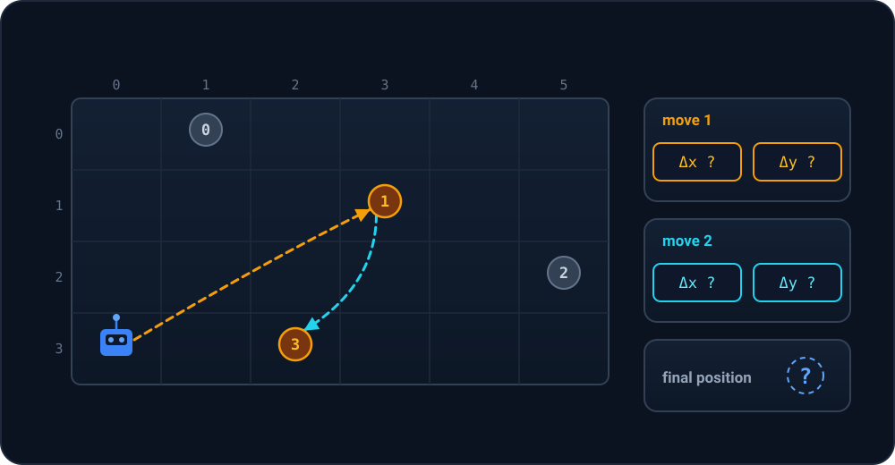

### 15. Фотография финиша

Три участника пробегают 100 метров за 10, 12 и 15 секунд.
Считайте, что каждый бежит с постоянной скоростью.
Фотографию делают, когда самый быстрый участник пересекает финиш, через 10 секунд после старта.
Сколько метров ещё осталось пробежать каждому из двух других участников?

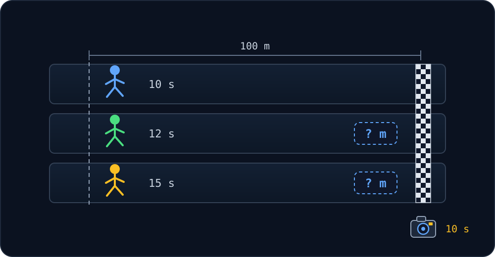

### 16. Панель быстрого доступа

В рюкзаке хранятся инструменты с запасом прочности.
Три ячейки панели быстрого доступа ссылаются на эти инструменты.
Назначьте один инструмент двум ячейкам.
Используйте его через одну заданную ячейку, уменьшив его прочность на заданную величину.
Покажите, что обе ячейки видят изменение инструмента в рюкзаке.

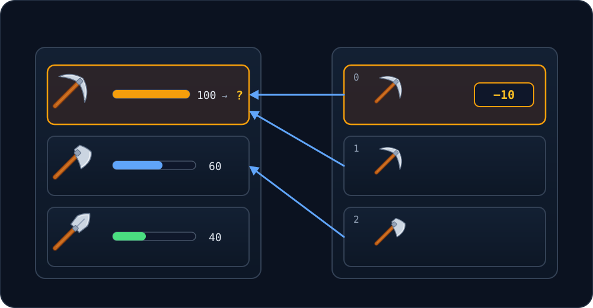

### 17. Панели освещения

Две панели управления ссылаются каждая на три установленные лампы с регулируемой яркостью.
Одна лампа доступна с обеих панелей.
Измените её яркость через заданную позицию на одной панели, затем прочитайте её через другую панель.


### 18. Пьедестал

Три места на пьедестале ссылаются на участников из общего списка; у каждого участника есть денежный баланс.
Поменяйте местами первые две позиции, затем начислите заданный приз участнику на заданной позиции.
Выведите баланс этого участника из общего списка.

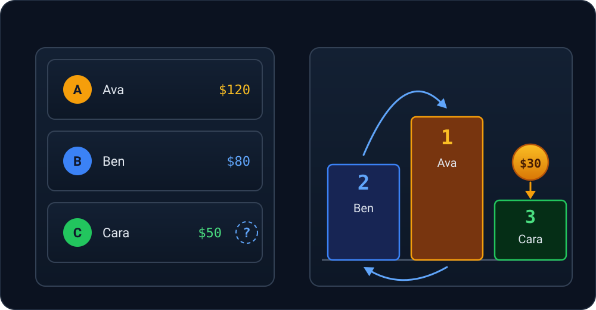

### 19. Зарядное устройство

Три занятые ячейки зарядного устройства ссылаются на существующие аккумуляторы с зарядом и ёмкостью.
Добавьте заданный заряд аккумулятору в заданной ячейке, затем поменяйте местами две заданные ячейки.
Сообщите заряд перемещённого аккумулятора.
Считайте, что после зарядки заряд аккумулятора не превысит его ёмкость.

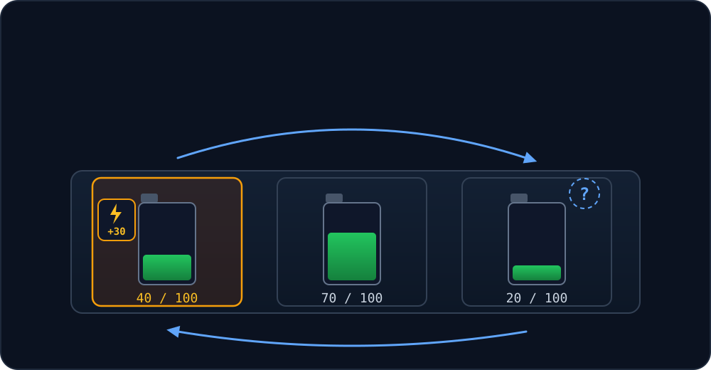

### 20. Фотоальбомы

Два альбома ссылаются каждый на три фотографии из общей библиотеки; у каждой фотографии есть ширина и высота.
Одна фотография из библиотеки есть в обоих альбомах.
Поверните её через заданную позицию в альбоме, поменяв местами ширину и высоту.
Поворот изменяет фотографию в библиотеке; покажите новые размеры через другой альбом.

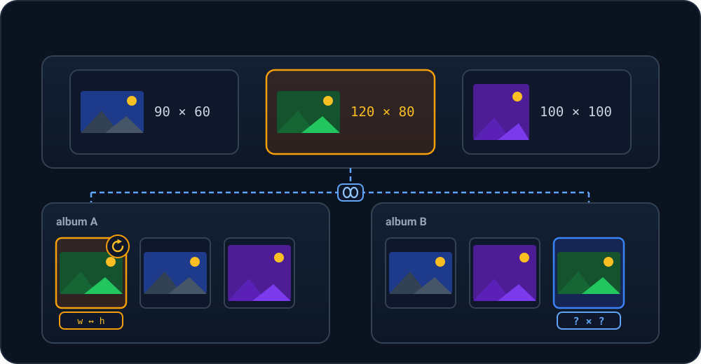

### 21. Витрины магазина

Две витрины ссылаются каждая на три записи о товарах с ценами и количеством в наличии.
Один товар представлен на обеих витринах.
Продайте одну единицу товара, выбранного по заданной позиции на витрине, уменьшив его запас.
Добавьте цену товара в кассу магазина и сообщите оставшийся запас через другую витрину.

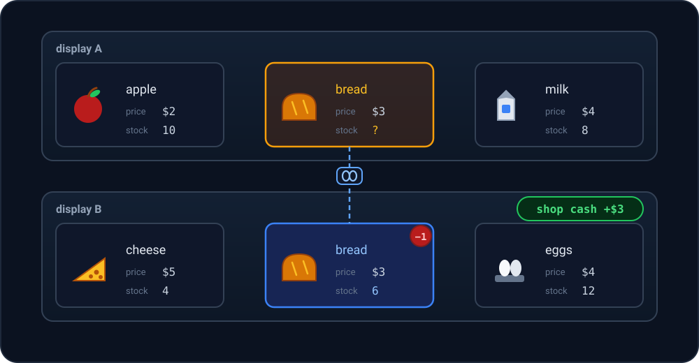
