<!-- course-site-backlink:start -->
[Этот урок на сайте](https://AntonC9018.github.io/uniCourse_csharp/ru/labs/basic/advanced-practice/)
<!-- course-site-backlink:end -->
# Продвинутая практика

> Эта лаба добавлена для практики. После неё предполагается, что вы умеете решать подобные задачи.

## Что нужно развить в данной работе

- Более продвинутое моделирование предметной области;
- Хранение фиксированного количества элементов в массивах, включая массив внутри типа;
- Работа с пустыми местами: пустая ссылка означает отсутствие объекта;
- Изменение объектов через ссылки: изменение видно через любую ссылку на тот же объект;
- Написание маленьких функций, возвращающих `bool` или количество,
  с использованием `if` с ранними возвратами (guard clauses) и `switch` по `enum`;
- Предусловия функций (`Debug.Assert`), которые объясняются в этой работе;
- Моделирование результата операции и планирование мутации как значений;
- Перебор объектов в цикле, подсчёт пустых мест, поиск первого пустого места.

## Предусловия и результаты

**Предусловие** — то, что уже должно быть верно при вызове функции.
Например, функции, которая меняет элемент массива, нужен индекс существующего элемента.
Передать индекс за пределами массива — ошибка в вызывающем коде.
Для её обнаружения используют `Debug.Assert`.

**Обычный результат** может быть неудачным, даже если вызывающий код написан правильно.
Бронирование может не удаться, потому что все билеты проданы,
но для программы это обычная ситуация.
Верните результат, чтобы вызывающий код мог на него отреагировать.

### Пример: запись очков игрока

В игре очки трёх игроков хранятся по индексам 0, 1 и 2.
`RecordScore` меняет очки существующего игрока:

```csharp
using System.Diagnostics;

static void RecordScore(int[] scores, int playerIndex, int score)
{
    Debug.Assert(playerIndex >= 0 && playerIndex < scores.Length);
    scores[playerIndex] = score;
}
```

<details>
<summary>
Что произойдёт, если игра вызовет <code>RecordScore(scores, 3, 10)</code>?
</summary>

Игрока с индексом 3 нет, поэтому проверка `Debug.Assert` не пройдёт.
Вызывающий код перепутал номер игрока 3 с индексом 2.
Если вместо этого вернуть `false`, игра может проигнорировать неудачное обновление
и продолжить работу со старыми очками. Ошибка проявится лишь при объявлении неверного победителя.
Нужно исправить индекс в вызывающем коде; неудачное обновление очков — не обычный исход игры.

</details>

> `Debug.Assert` — инструмент отладки: без символа `DEBUG` эти вызовы не компилируются.
> Вызывающий код всё равно должен передавать допустимые аргументы.
> `Debug.Assert` никогда не заменяет проверку пользовательского ввода.

### Пример: бронирование билета в кино

В кинотеатре могут закончиться билеты. `BookTicket` сообщает, удалось ли забронировать билет.
Параметр `ref` позволяет менять число билетов у вызывающего кода;
при вызове его тоже указывают: `BookTicket(ref ticketsLeft)`.

```csharp
static bool BookTicket(ref int ticketsLeft)
{
    Debug.Assert(ticketsLeft >= 0);
    if (ticketsLeft == 0)
    {
        return false;
    }
    ticketsLeft--;
    return true;
}
```

Отрицательное число оставшихся билетов было бы ошибкой;
именно это здесь проверяет `Debug.Assert`.
Ноль оставшихся билетов допустим — он просто означает, что все билеты проданы.

<details>
<summary>
Остался один билет. Что произойдёт, если два покупателя по очереди попытаются его забронировать?
</summary>

Первый вызов уменьшит `ticketsLeft` с 1 до 0 и вернёт `true`.
Второй оставит 0 и вернёт `false`.
Вызывающий код может показать «билеты закончились» или предложить другой сеанс.
Если заменить `if` на `Debug.Assert(ticketsLeft > 0)`, исправная программа остановится
просто потому, что последний билет уже продан.

</details>

Другие проверки, для которых **не нужен** `Debug.Assert`:

- В форме входа ввели неверный пароль.
  `Debug.Assert(enteredPassword == savedPassword)` остановит программу
  при обычной неудачной попытке входа.
  Программа должна сообщить, что пароль не подошёл, и дать пользователю попробовать ещё раз.
- Поиск студента `"Mira"` никого не нашёл.
  `Debug.Assert(found != null)` превратит обычное отсутствие результата в ошибку программы.
  Верните `null`, чтобы вызывающий код мог показать «студент не найден».
- В поле возраста пользователь ввёл `-5`.
  `Debug.Assert(age >= 0)` остановит программу вместо обработки неверного ввода.
  Сообщите о неверном возрасте и попросите другое значение, прежде чем его использовать.

### Пример: `TakeOut` и `TryTakeOut`

Для одного действия можно написать две функции с разными требованиями:

- `TryOperation` — мягкий вариант: допускает обычную неудачу и возвращает результат для проверки.
- `Operation` — жёсткий вариант: необходимые для действия условия должны быть выполнены.
  Если необходимое условие не выполнено, это ошибка в программе, которую обнаружит `Debug.Assert`.

В микроволновке либо стоит одно блюдо, либо ничего нет.
Используйте `TakeOut`, если в этом месте программы уже известно, что внутри есть еда.
Функция возвращает блюдо и освобождает микроволновку; вызвать её для пустой микроволновки — ошибка.
Вызывайте `TryTakeOut`, когда пустая микроволновка — ожидаемая ситуация, которую нужно обработать.
Она возвращает `Meal?`: блюдо при успехе или `null`, если брать нечего.

```csharp
using System.Diagnostics;

class Meal
{
    public string name = "";
}

class Microwave
{
    public Meal? meal;
}

static Meal TakeOut(Microwave microwave)
{
    Debug.Assert(microwave.meal != null);
    Meal meal = microwave.meal;
    microwave.meal = null;
    return meal;
}

static Meal? TryTakeOut(Microwave microwave)
{
    if (microwave.meal == null)
    {
        return null;
    }
    return TakeOut(microwave);
}
```

`TryTakeOut` проверяет, не пуста ли микроволновка, прежде чем вызвать `TakeOut`.
Если блюдо есть, обе функции вынимают его; разница лишь в случае пустой микроволновки.

```csharp
Microwave microwave = new() { meal = new Meal { name = "soup" } };
Meal soup = TakeOut(microwave);
Meal? second = TryTakeOut(microwave);
```

<details>
<summary>Что вернут вызовы? А если во втором вызвать <code>TakeOut</code>?</summary>

`TakeOut` вернёт суп, после чего микроволновка будет пуста.
`TryTakeOut` затем вернёт `null`, оставив её пустой.
Вызывающий код может проверить `second != null` и решить приготовить что-нибудь ещё.
Повторный `TakeOut` не пройдёт проверку `Debug.Assert`: вызывающий код пытается вынуть блюдо,
не убедившись, что оно есть.

</details>

Выбирайте функцию, требования которой подходят вызывающему коду.
Не вызывайте `TakeOut`, чтобы проверить, есть ли внутри еда;
для этого нужна `TryTakeOut`.

## Задачи для практики

- **Книжная полка.** Полка вмещает 5 книг. У каждой книги есть название.
  Положите «Атлас» в слот 2 и уберите книгу из слота 0.
  Посчитайте, сколько слотов пустует.

  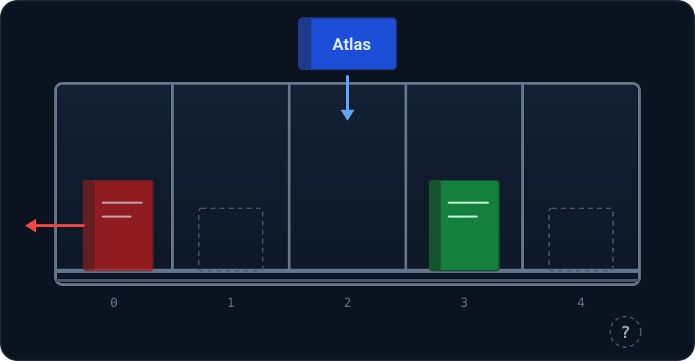

  <details>
  <summary>
  Возможное решение
  </summary>

  Слот полки либо хранит книгу, либо пуст, поэтому тип слота — `Book?`:
  пустой слот — это `null`.
  Классы объединяют данные: название книги и слоты полки.

  ```csharp
  class Book
  {
      public string title;
  }

  class Bookshelf
  {
      public Book?[] slots = new Book?[5];
  }
  ```

  Полка и книга — классы, поэтому при передаче параметром они не копируются:
  изменения в слотах видит вызывающий код.

  Допустим, слоты 0 и 3 хранят книги, а остальные пусты.
  Чтобы положить «Атлас» в слот 2, нужны две проверки.
  Вызывающий код должен выбрать индекс в пределах массива.
  `Debug.Assert` обнаружит индекс вроде 5: такого слота на этой полке нет.
  В слоте 2 не должно быть книги — это обычные данные,
  поэтому, если слот занят, функция возвращает `false`.
  В слоте 0 слот занят, поэтому книгу не кладём и ничего не меняем:

  ```csharp
  static bool ShelveBook(Bookshelf shelf, int index, Book book)
  {
      Debug.Assert(index >= 0 && index < shelf.slots.Length);
      if (shelf.slots[index] != null)
      {
          return false;
      }
      shelf.slots[index] = book;
      return true;
  }
  ```

  Чтобы взять книгу, тоже нужен существующий слот, поэтому `Debug.Assert` проверяет индекс;
  в слоте 0 есть книга, поэтому очищаем его (`null`) и возвращаем `true`;
  пустой слот — это обычные данные, поэтому возвращаем `false`:

  ```csharp
  static bool TakeBook(Bookshelf shelf, int index)
  {
      Debug.Assert(index >= 0 && index < shelf.slots.Length);
      if (shelf.slots[index] == null)
      {
          return false;
      }
      shelf.slots[index] = null;
      return true;
  }
  ```

  Чтобы посчитать пустые, просто обходим каждый слот по очереди в цикле `for`
  и прибавляем 1 за каждый слот без книги:

  ```csharp
  static int EmptyCount(Bookshelf shelf)
  {
      int count = 0;
      for (int i = 0; i < shelf.slots.Length; i++)
      {
          if (shelf.slots[i] == null)
          {
              count++;
          }
      }
      return count;
  }
  ```

  Использование в основной функции:

  ```csharp
  Bookshelf shelf = new();
  shelf.slots[0] = new Book
  {
      title = "Справочник",
  };
  shelf.slots[3] = new Book
  {
      title = "Словарь",
  };
  ShelveBook(shelf, 2, new Book
  {
      title = "Атлас",
  });
  TakeBook(shelf, 0);
  int free = EmptyCount(shelf);
  ```
  </details>

- **Из холодильника в морозилку.** Холодильник вмещает 3 продукта, морозилка вмещает 2 продукта.
  У каждого продукта есть название.
  Переместите пиццу с полки 1 холодильника на полку 0 морозилки.
  Старое место при этом освобождается.

  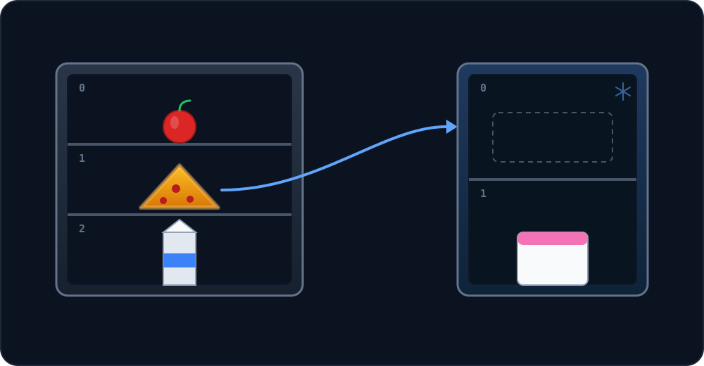

  <details>
  <summary>
  Возможное решение
  </summary>

  Тот же принцип с полками, только контейнеров два: у холодильника 3 полки, у морозилки 2,
  каждая полка либо хранит продукт, либо пуста:

  ```csharp
  class Food
  {
      public string name;
  }

  class Fridge
  {
      public Food?[] shelves = new Food?[3];
  }

  class Freezer
  {
      public Food?[] shelves = new Food?[2];
  }
  ```

  Допустим, на полке 1 холодильника лежит пицца, а полка 0 морозилки пуста.
  Вызывающий код должен выбрать существующие полки в обоих контейнерах.
  Две проверки `Debug.Assert` обнаружат выход за пределы любого из массивов.
  Есть ли продукт в источнике и свободна ли цель — это обычные данные,
  поэтому эти проверки возвращают `false`.
  Затем два шага: переносим ссылку на продукт на полку 0 морозилки,
  очищаем полку 1 холодильника.
  С этого момента пицца живёт ровно в одном месте — в этом и состоит идея владения.
  Неудачная проверка данных возвращает `false` и ничего не трогает:

  ```csharp
  static bool MoveFood(Fridge from, int fromIndex, Freezer to, int toIndex)
  {
      Debug.Assert(fromIndex >= 0 && fromIndex < from.shelves.Length);
      Debug.Assert(toIndex >= 0 && toIndex < to.shelves.Length);
      if (from.shelves[fromIndex] == null)
      {
          return false;
      }
      if (to.shelves[toIndex] != null)
      {
          return false;
      }
      to.shelves[toIndex] = from.shelves[fromIndex];
      from.shelves[fromIndex] = null;
      return true;
  }
  ```

  Использование в основной функции:

  ```csharp
  Fridge fridge = new();
  fridge.shelves[1] = new Food
  {
      name = "pizza",
  };
  Freezer freezer = new();
  bool moved = MoveFood(fridge, 1, freezer, 0);
  ```
  </details>

- **Разогрев супа.** Микроволновка либо вмещает одно блюдо, либо пуста.
  У каждого блюда есть название и состояние нагрева: холодное или горячее.
  Положите холодный суп внутрь, разогрейте до горячего состояния, затем достаньте.

  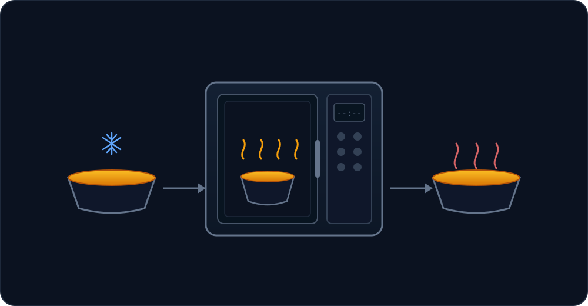

  <details>
  <summary>
  Возможное решение
  </summary>

  Здесь всего один слот — поддон — плюс новый параметр, за которым нужно следить:
  состояние нагрева, которое бывает холодным или горячим:

  ```csharp
  enum Warmth
  {
      Cold,
      Hot,
  }

  class Meal
  {
      public string name;
      public Warmth warmth;
  }

  class Microwave
  {
      public Meal? tray;
  }
  ```

  Поддон изначально пуст. Когда кладём холодный суп внутрь, поддон свободен,
  поэтому сохраняем блюдо и возвращаем `true`;
  при второй попытке поддон уже занят, поэтому возвращаем `false`:

  ```csharp
  static bool PutMeal(Microwave m, Meal meal)
  {
      if (m.tray != null)
      {
          return false;
      }
      m.tray = meal;
      return true;
  }
  ```

  При разогреве внутри есть блюдо, поэтому меняем его состояние на горячее.
  При разогреве пустой микроволновки внутри ничего нет, поэтому возвращаем `false`:

  ```csharp
  static bool HeatMeal(Microwave m)
  {
      if (m.tray == null)
      {
          return false;
      }
      m.tray.warmth = Warmth.Hot;
      return true;
  }
  ```

  При доставании возвращаем горячий суп вызывающему коду,
  очищаем поддон и возвращаем `null`, если поддон пуст:

  ```csharp
  static Meal? TakeMeal(Microwave m)
  {
      if (m.tray == null)
      {
          return null;
      }
      Meal? result = m.tray;
      m.tray = null;
      return result;
  }
  ```

  Использование в основной функции:

  ```csharp
  Microwave mw = new();
  PutMeal(mw, new Meal
  {
      name = "soup",
      warmth = Warmth.Cold,
  });
  HeatMeal(mw);
  Meal? lunch = TakeMeal(mw);
  ```
  </details>

- **Выпить зелье.** У героя есть здоровье и щит.
  Зелье бывает красным, синим или испорченным.
  Дайте герою 1 красное зелье.
  Красное добавляет 20 здоровья, синее добавляет 10 щита, испорченное ничего не делает.

  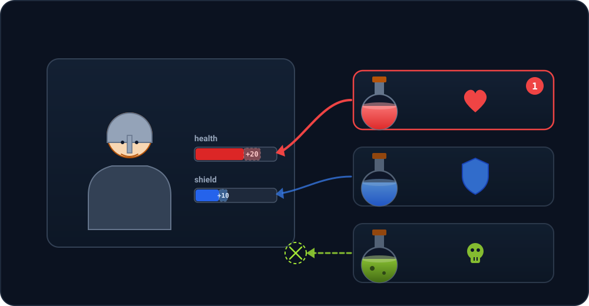

  <details>
  <summary>
  Возможное решение
  </summary>

  Вид зелья определяет эффект, поэтому оформляем его как `enum`.
  Герой и зелье — классы, нужные лишь для группировки данных:

  ```csharp
  enum PotionKind
  {
      Red,
      Blue,
      Spoiled,
  }

  class Potion
  {
      public PotionKind kind;
  }

  class Hero
  {
      public int health;
      public int shield;
  }
  ```

  Красное зелье поднимает здоровье героя с 50 до 70:
  ветка `Red` добавляет 20 и возвращает `true`.
  Синее зелье идёт в следующую ветку и добавляет 10 щита.
  Испорченное зелье идёт в последнюю ветку и возвращает `false`,
  не меняя героя.
  Все значения `PotionKind` обработаны, поэтому выход из `switch`
  означает испорченное значение — его ловит `Debug.Assert`:

  ```csharp
  static bool DrinkPotion(Hero hero, Potion potion)
  {
      switch (potion.kind)
      {
          case PotionKind.Red:
              hero.health += 20;
              return true;
          case PotionKind.Blue:
              hero.shield += 10;
              return true;
          case PotionKind.Spoiled:
              return false;
      }
      Debug.Assert(false); // все значения PotionKind обработаны выше
      return false;        // недостижимо
  }
  ```

  Использование в основной функции:

  ```csharp
  Hero hero = new()
  {
      health = 50,
      shield = 0,
  };
  DrinkPotion(hero, new Potion
  {
      kind = PotionKind.Red,
  });
  ```
  </details>

- **Замачивание белья.** Корзина вмещает 3 вещи.
  В прачечной 2 корзины.
  У каждой вещи есть метка и состояние: грязная, замоченная или чистая.
  Достаньте каждую чистую рубашку из корзины 0, затем замочите каждую грязную рубашку в корзине 0.
  Посчитайте, сколько достали и сколько замочили.

  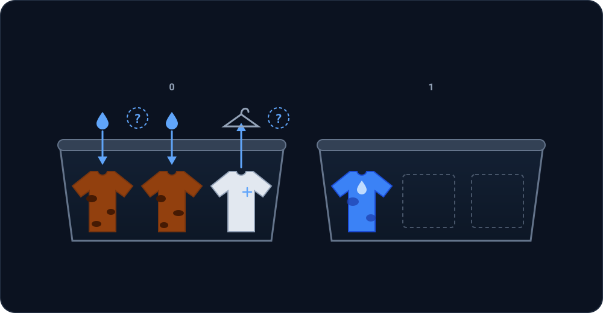

  <details>
  <summary>
  Возможное решение
  </summary>

  Новая идея здесь — вложенность: `Basket` хранит массив,
  а `Laundry` хранит корзины:

  ```csharp
  enum ClothState
  {
      Dirty,
      Soaked,
      Clean,
  }

  class Cloth
  {
      public string label;
      public ClothState state;
  }

  class Basket
  {
      public Cloth?[] slots = new Cloth?[3];
  }

  class Laundry
  {
      public Basket[] baskets = [new Basket(), new Basket()];
  }
  ```

  Допустим, слоты 0 и 1 корзины 0 хранят грязные рубашки, а слот 2 хранит чистую рубашку.
  Сначала достаём чистые: цикл перебирает слоты по очереди
  и очищает каждый слот с чистой вещью, увеличивая счётчик на 1 (в примере счётчик станет равен 1).
  Затем замачиваем грязные: второй цикл по тем же слотам
  помечает каждую грязную вещь замоченной, увеличивая счётчик на 1 (в примере счётчик дойдёт до 2).
  Пустой слот пропускается в обоих циклах.

  ```csharp
  static int TakeCleanShirts(Basket basket)
  {
      int taken = 0;
      for (int i = 0; i < basket.slots.Length; i++)
      {
          Cloth? cloth = basket.slots[i];
          if (cloth == null)
          {
              continue;
          }
          if (cloth.state != ClothState.Clean)
          {
              continue;
          }
          basket.slots[i] = null;
          taken++;
      }
      return taken;
  }

  static int SoakBasket(Basket basket)
  {
      int soaked = 0;
      for (int i = 0; i < basket.slots.Length; i++)
      {
          Cloth? cloth = basket.slots[i];
          if (cloth == null)
          {
              continue;
          }
          if (cloth.state != ClothState.Dirty)
          {
              continue;
          }
          cloth.state = ClothState.Soaked;
          soaked++;
      }
      return soaked;
  }
  ```

  Использование в основной функции:

  ```csharp
  Laundry laundry = new();
  laundry.baskets[0].slots[0] = new Cloth
  {
      label = "shirt",
      state = ClothState.Dirty,
  };
  laundry.baskets[0].slots[1] = new Cloth
  {
      label = "shirt",
      state = ClothState.Dirty,
  };
  laundry.baskets[0].slots[2] = new Cloth
  {
      label = "shirt",
      state = ClothState.Clean,
  };
  int taken = TakeCleanShirts(laundry.baskets[0]);
  int soaked = SoakBasket(laundry.baskets[0]);
  ```
  </details>

- **Тюнинг машины.** Гараж вмещает 4 машины. У каждой машины есть модель, мощность и цена.
  Тюнингуйте машину 2: увеличьте мощность на 10, а цену — на 1000 за каждую добавленную единицу мощности.

  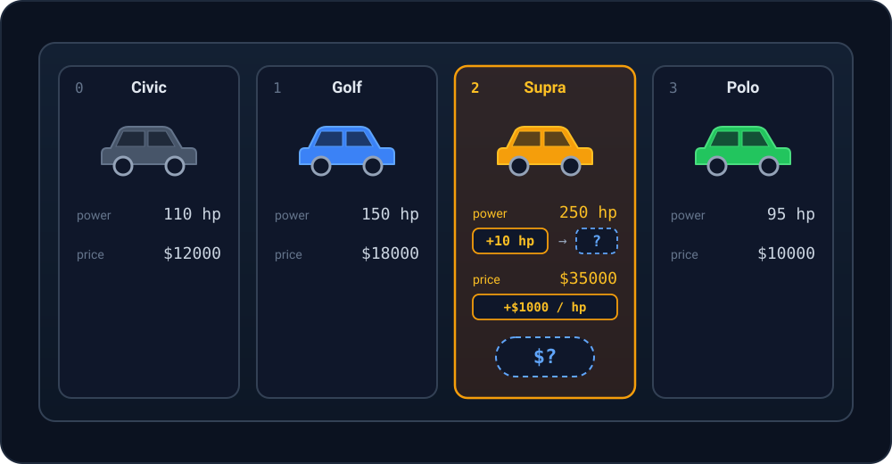

- **Мойка машин.** Мойка вмещает 3 машины. Каждая машина бывает чистой или грязной.
  Помойте каждую грязную машину. Посчитайте, сколько было помыто.

  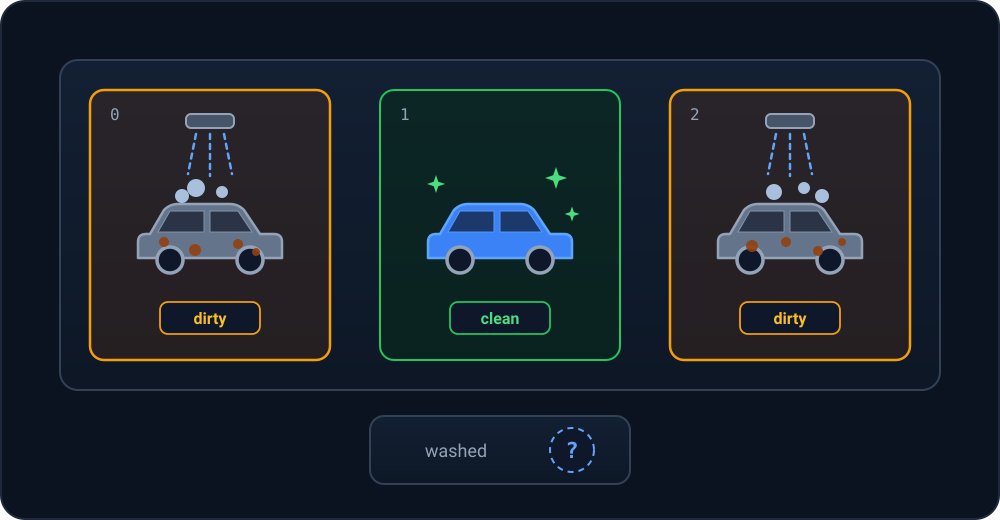

- **Парковка.** На парковке 2 этажа по 4 места.
  Каждое место либо хранит машину, либо пусто.
  Поставьте новую машину на первое пустое место.

  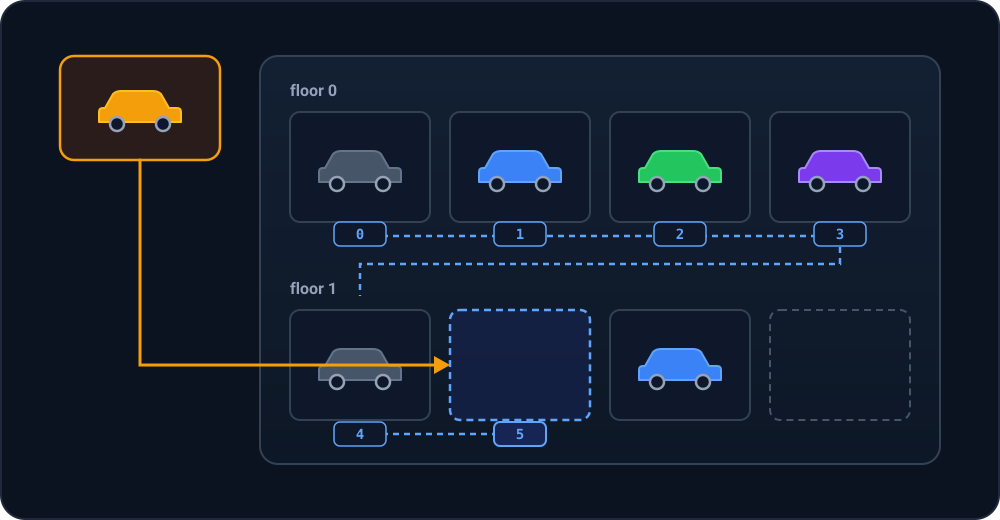

- **Двигатель машины.** В гараже 4 машины. У каждой машины свой двигатель. У двигателя есть износ от 0 до 100.
  Проверьте двигатель машины 1 и отремонтируйте его до износа 0.

  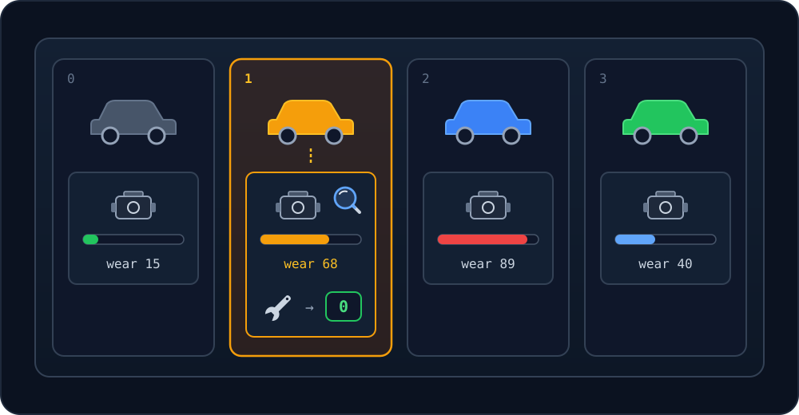

- **Рейлинг для чашек.** Рейлинг рассчитан на 4 чашки. Некоторые крючки пусты.
  Повесьте новую чашку на первый пустой крючок и снимите чашку с крючка 1.
  При перемещении владение передаётся: скопируйте ее, затем очистите старое место.

  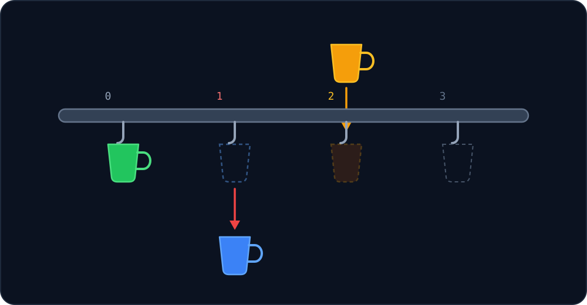

- **Отряд героев.** Отряд вмещает 3 героев. У каждого героя есть здоровье и щит.
  Полечите героя 1 на 20 единиц здоровья. Посчитайте, скольким героям все еще нужно лечение.

  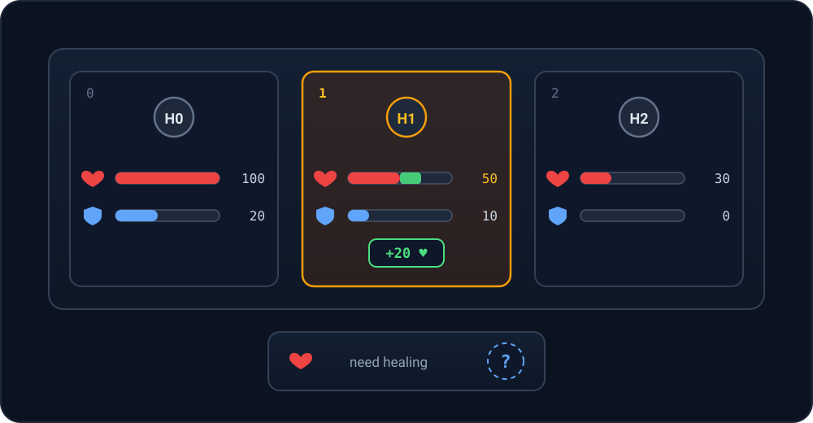

- **Активный бафф.** Игрок хранит ссылку на активный бафф. Отсутствие баффа означает пустую ссылку.
  Дайте игроку 1 бафф на щит до боя и заберите его после боя.

  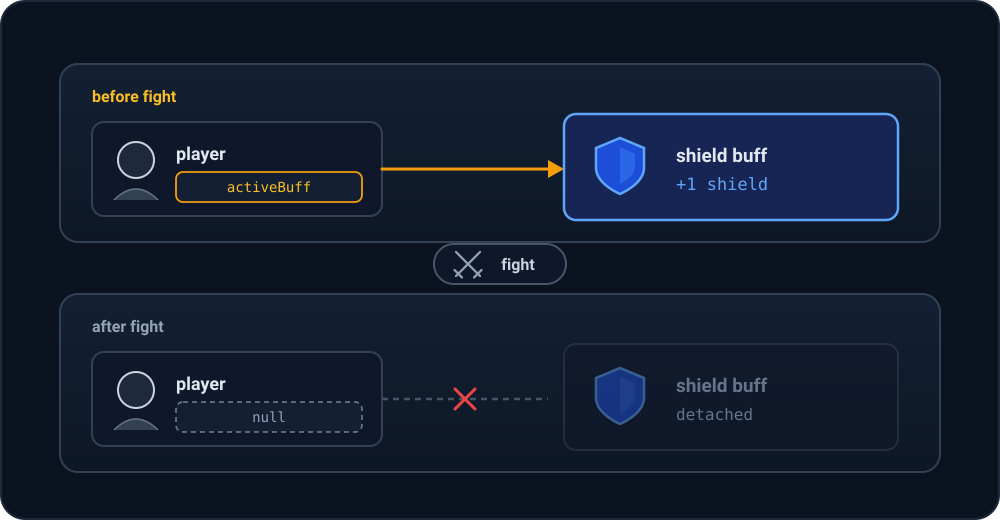

- **Класс.** В комнате 2 ряда по 3 парты. Каждая парта либо хранит ученика, либо пуста.
  Посчитайте пустые парты. Посадите новичка за первую пустую парту.

  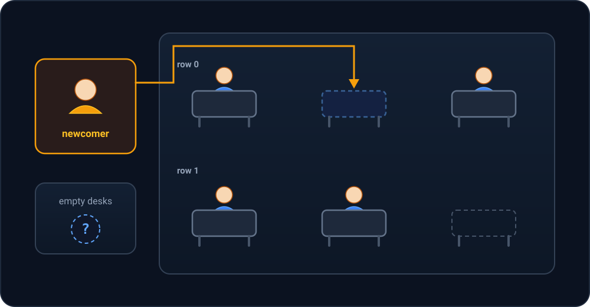

- **Найти пиццу.** Холодильник вмещает 3 продукта с названиями.
  Найдите пиццу и переместите ее на полку 1 морозилки. Верните признак, была ли она найдена.

  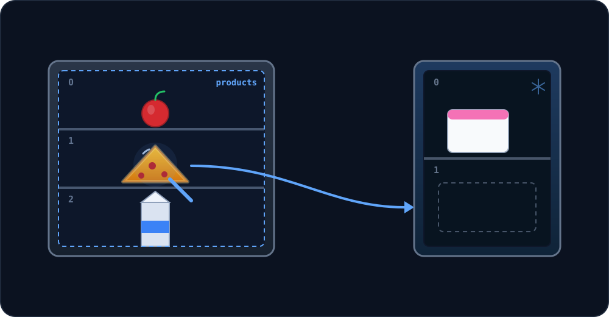

  <details>
  <summary>
  Возможное решение
  </summary>

  Те же холодильник и морозилка, что и раньше, но поиск выполняется по массиву полок,
  а параметры «что найти» и «куда положить» сгруппированы в отдельный класс запроса.
  Имя функции — то же, что у предыдущего `MoveFood`, но параметры другие (перегрузка):

  ```csharp
  class Food
  {
      public string name;
  }

  class Fridge
  {
      public Food?[] shelves = new Food?[3];
  }

  class Freezer
  {
      public Food?[] shelves = new Food?[2];
  }

  class FoodMove
  {
      public string name;
      public int toIndex;
  }
  ```

  Допустим, на полке 1 холодильника лежит пицца, а полка 1 морозилки пуста.
  Вызывающий код упаковывает `"pizza"` и `1` в `FoodMove`.
  Целевой индекс должен указывать на существующую полку морозилки;
  это проверяет `Debug.Assert`.
  Занятая целевая полка — обычная ситуация: функция возвращает `false`.
  Цикл перебирает полки холодильника по очереди: на полке 0 пиццы нет, поэтому пропускаем её;
  на полке 1 есть пицца, поэтому переносим ссылку в морозилку и очищаем старую полку,
  затем сигнализируем об успехе, возвращая `true`.
  Если ни на одной полке нет продукта с таким именем, возвращаем `false` и ничего не меняем:

  ```csharp
  static bool MoveFood(Fridge fridge, Freezer to, FoodMove move)
  {
      Debug.Assert(move.toIndex >= 0 && move.toIndex < to.shelves.Length);
      if (to.shelves[move.toIndex] != null)
      {
          return false;
      }
      for (int i = 0; i < fridge.shelves.Length; i++)
      {
          Food? slot = fridge.shelves[i];
          if (slot == null)
          {
              continue;
          }
          if (slot.name != move.name)
          {
              continue;
          }
          to.shelves[move.toIndex] = slot;
          fridge.shelves[i] = null;
          return true;
      }
      return false;
  }
  ```

  Изменения в массиве полок видны снаружи, потому что массивы — ссылочный тип:
  функция получает не копию полок, а ссылку на тот же массив.

  Использование в основной функции:

  ```csharp
  Fridge fridge = new();
  fridge.shelves[1] = new Food
  {
      name = "pizza",
  };
  Freezer freezer = new();
  bool moved = MoveFood(fridge, freezer, new FoodMove
  {
      name = "pizza",
      toIndex = 1,
  });
  ```
  </details>

- **Замочить посуду.** На кухне 2 сушилки по 3 тарелки. Каждая тарелка бывает грязной или замоченной.
  Замочите каждую грязную тарелку в сушилке 0.

  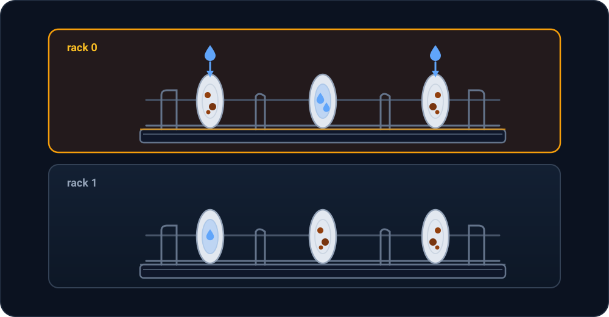

- **Комнаты библиотеки.** В библиотеке 2 комнаты по 3 слота. Каждый слот либо хранит книгу, либо пуст.
  Положите «Атлас» в первый пустой слот комнаты 1.

  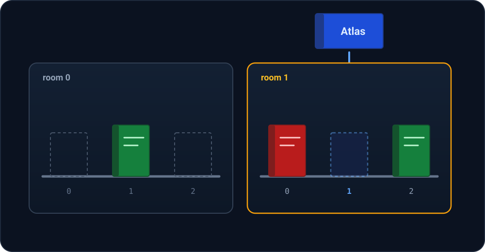

- **Светофор.** На перекрестке 3 светофора. Каждый светофор бывает красным, желтым или зеленым.
  Переключите светофор 2 на следующий цвет через `switch`.

  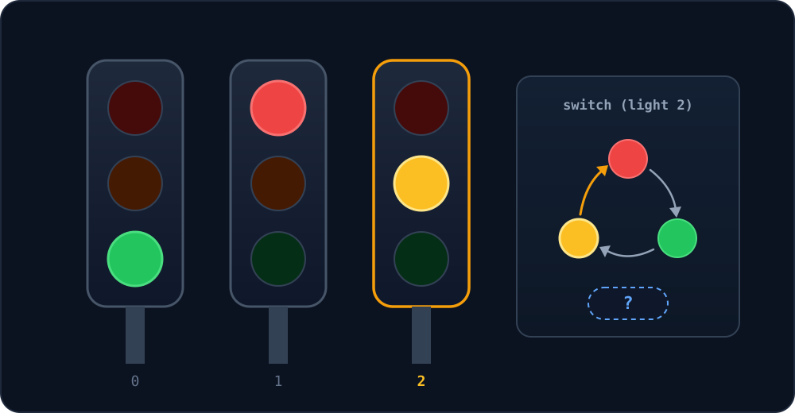

- **Аптечка.** Шкафчик вмещает 4 коробки. Каждая коробка бывает свежей или просроченной.
  Верните признак, можно ли использовать коробку 1. Выбросите коробку 1, если она просрочена.

  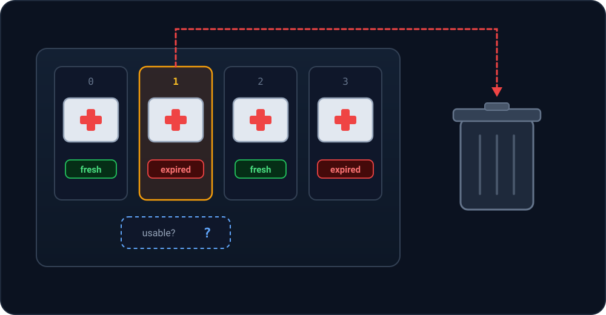

- **Столовая.** Столовая хранит 3 супа и 3 хлеба.
  Подайте суп 1 с хлебом 1. При подаче оба забираются.

  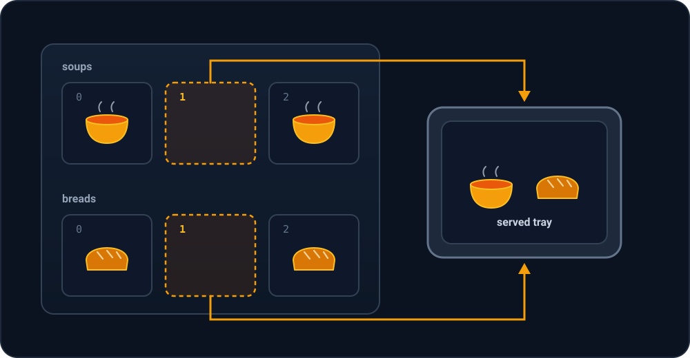

- **Горячая цепочка.** На кухне есть холодильник, морозилка и микроволновка.
  Положите пиццу с полки 0 холодильника в микроволновку, разогрейте ее,
  затем переместите на полку 1 морозилки. Каждый шаг возвращает признак, получилось ли его выполнить.

  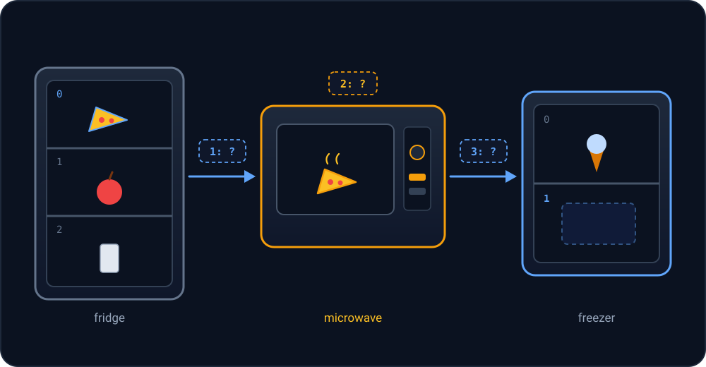

- **Барбершоп.** В салоне есть место для 4 ожидающих клиента и 2 мастера.
  У каждого клиента есть метка и остаток стрижки в минутах — сколько ещё нужно состричь.
  Клиенты создаются отдельно в основной функции, а салон хранит только ссылки на них.
  Добавьте каждого клиента на первое свободное место в очереди.
  Назначьте свободных мастеров ожидающим клиентам.
  Каждый тик каждый занятый мастер состригает 1 минуту.
  Когда клиент полностью пострижен, мастер освобождается.
  Симулируйте через цикл `while`, пока все клиенты не будут обслужены.

  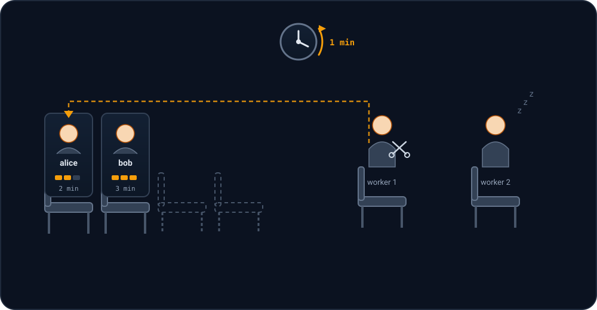

  <details>
  <summary>
  Возможное решение
  </summary>

  Клиенты живут в основной функции, а салон хранит только ссылки на них —
  поэтому и очередь, и мастера хранят ссылки, а не копии.
  Изменения через ссылку отражаются на самом клиенте: один и тот же клиент
  сначала доступен через очередь, затем через мастера.

  ```csharp
  struct MinutesLeft
  {
      public int value;
  }

  class Client
  {
      public string label;
      public MinutesLeft hairCompletion;
  }

  class Worker
  {
      public Client? assignedClient;
  }

  class Shop
  {
      public Client?[] queue = new Client?[4];
      public Worker[] workers = [new Worker(), new Worker()];
  }
  ```

  Добавление кладёт ссылку на первое свободное место в очереди.
  Поиск этого места — отдельная функция:
  она отдаёт индекс слота или `-1`, когда очередь полна.
  Добавление просто заполняет этот слот.
  Аннотация `Client` не запрещает `null` во время выполнения:
  это обещание вызывающего кода, поэтому его проверяет `Debug.Assert`.
  Переполненная очередь — штатная ситуация, о ней сообщается возвращаемым значением:

  ```csharp
  enum AddClientResult
  {
      Added,
      FailedQueueFull,
  }

  static int FindFreeSlot(Shop shop)
  {
      for (int i = 0; i < shop.queue.Length; i++)
      {
          if (shop.queue[i] == null)
          {
              return i;
          }
      }
      return -1;
  }

  static AddClientResult AddClient(Shop shop, Client client)
  {
      Debug.Assert(client != null); // клиент всегда существует
      int slot = FindFreeSlot(shop);
      if (slot < 0)
      {
          return AddClientResult.FailedQueueFull;
      }
      shop.queue[slot] = client;
      return AddClientResult.Added;
  }
  ```

  Взятие первого ожидающего клиента — отдельная функция:
  поиск первого занятого места отдаёт его индекс,
  взятие очищает этот слот и возвращает клиента или `null`.
  Назначение просто раздаёт каждому свободному мастеру то, что вернёт эта функция, —
  `null` просто оставляет мастера свободным:

  ```csharp
  static int FindTakenSlot(Shop shop)
  {
      for (int i = 0; i < shop.queue.Length; i++)
      {
          if (shop.queue[i] != null)
          {
              return i;
          }
      }
      return -1;
  }

  static Client? TakeFirstWaiting(Shop shop)
  {
      int slot = FindTakenSlot(shop);
      if (slot < 0)
      {
          return null;
      }
      Client? found = shop.queue[slot];
      shop.queue[slot] = null;
      return found;
  }

  static void AssignWorkers(Shop shop)
  {
      for (int i = 0; i < shop.workers.Length; i++)
      {
          Worker worker = shop.workers[i];
          if (worker.assignedClient != null)
          {
              continue;
          }
          worker.assignedClient = TakeFirstWaiting(shop);
      }
  }
  ```

  `CutOneMinute` можно вызывать, только если до конца стрижки осталось больше нуля минут.
  `Debug.Assert` обнаружит попытку продолжить уже законченную стрижку.
  `TickWorker` допускает ноль минут: такой клиент уже готов.
  Отрицательная длительность — ошибка; проверка не даёт работнику остаться занятым навсегда:

  ```csharp
  static void CutOneMinute(Client client)
  {
      Debug.Assert(client.hairCompletion.value > 0); // должно остаться что стричь
      client.hairCompletion.value--;
  }

  static bool ClientDone(Client client)
  {
      return client.hairCompletion.value == 0;
  }

  enum TickResult
  {
      Unassigned,
      StillWorking,
      Done,
  }

  static TickResult TickWorker(Worker worker)
  {
      Client? client = worker.assignedClient;
      if (client == null)
      {
          return TickResult.Unassigned;
      }
      Debug.Assert(client.hairCompletion.value >= 0); // длительность стрижки не может быть отрицательной
      if (client.hairCompletion.value > 0)
      {
          CutOneMinute(client);
      }
      if (ClientDone(client))
      {
          worker.assignedClient = null;
          return TickResult.Done;
      }
      return TickResult.StillWorking;
  }

  static void TickAllWorkers(Shop shop)
  {
      for (int i = 0; i < shop.workers.Length; i++)
      {
          TickWorker(shop.workers[i]);
      }
  }

  static bool HasWaitingClients(Shop shop)
  {
      for (int i = 0; i < shop.queue.Length; i++)
      {
          if (shop.queue[i] != null)
          {
              return true;
          }
      }
      return false;
  }

  static bool HasBusyWorkers(Shop shop)
  {
      for (int i = 0; i < shop.workers.Length; i++)
      {
          if (shop.workers[i].assignedClient != null)
          {
              return true;
          }
      }
      return false;
  }

  static bool ShopDone(Shop shop)
  {
      return !HasWaitingClients(shop) && !HasBusyWorkers(shop);
  }
  ```

  Симуляция — это обычный цикл `while`: сначала назначаем мастеров,
  затем вызываем тик всех мастеров, пока все клиенты не будут обслужены.
  Клиенты должны существовать дольше салона, потому что салон их никогда не копирует:

  ```csharp
  Client alice = new()
  {
      label = "alice",
      hairCompletion = new()
      {
          value = 2,
      },
  };
  Client bob = new()
  {
      label = "bob",
      hairCompletion = new()
      {
          value = 3,
      },
  };

  Shop shop = new();
  AddClient(shop, alice);
  AddClient(shop, bob);

  while (!ShopDone(shop))
  {
      AssignWorkers(shop);
      TickAllWorkers(shop);
  }
  ```
  </details>

- **Дроны-барберы.** Работники теперь дроны-автоматы:
  несколько дронов могут обрабатывать одного клиента одновременно,
  каждый состригает по 1 минуте за тик.
  Когда клиент полностью пострижен, освобождается каждый занятый им дрон.
  Симулируйте, пока все клиенты не будут обслужены.

  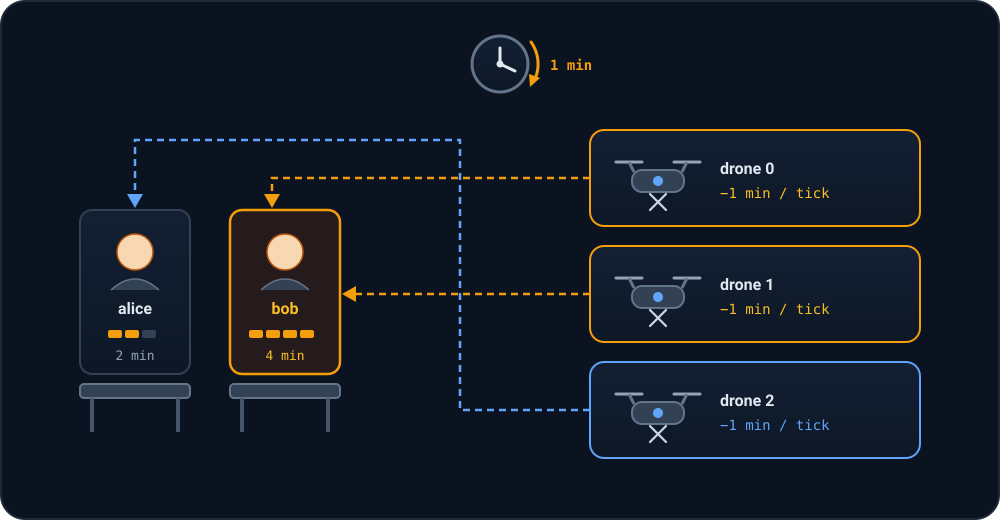

- **Парк аттракционов.** В парке 3 аттракциона.
  Каждый посетитель упорядочивает все 3 аттракциона по предпочтению,
  не посещает один и тот же аттракцион дважды подряд
  и может посетить аттракционы всего 4 раза.
  Каждый тик обслуженные посетители сходят с аттракциона —
  или покидают парк, когда квота исчерпана —
  а посетители без места занимают первый свободный аттракцион в порядке своих предпочтений.
  Если всё занято, они ждут, пока что-нибудь освободится.
  Симулируйте, пока все не исчерпают квоту.

  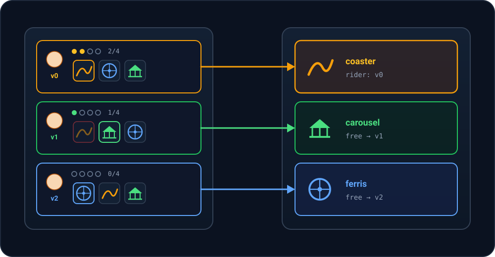

- **Рейс грузовика.** Грузовику нужно проехать заданное количество часов.
  В списке 3 водителя.
  Про каждого известно, сколько он может ехать без отдыха
  и сколько отдыха ему нужно за час езды.
  Напишите функцию, которая генерирует события рейса:
  кто сколько проехал и сколько времени грузовик простоял.
  Водитель едет до своего лимита (или пока не закончится рейс), а затем отдыхает
  столько, сколько положено: часы езды × норму отдыха. Пока он отдыхает,
  за руль садится другой водитель, а после отдыха снова готов ехать.
  Грузовик простаивает, только пока отдыхают все водители одновременно, —
  до тех пор, пока первый из них не отдохнёт.

  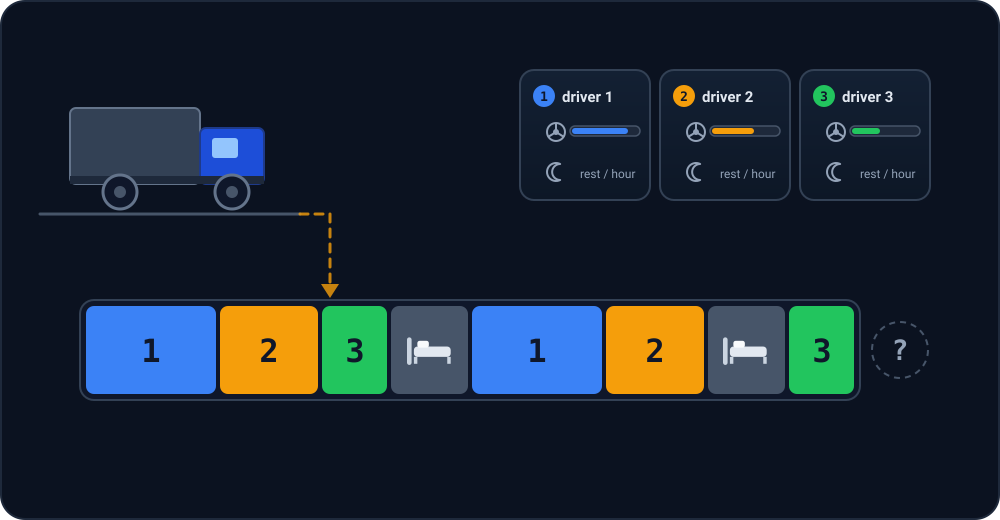

  <details>
  <summary>
  Возможное решение
  </summary>

  Состояние рейса — это сколько ещё осталось ехать
  и сколько отдыха ещё должен каждый водитель.
  Оставшийся отдых — это состояние самого водителя,
  как остаток стрижки у клиента в барбершопе, поэтому он хранится в его классе:

  ```csharp
  class Driver
  {
      public string name;
      public double maxDriveHours;    // сколько водитель может ехать без отдыха
      public double restPerDriveHour; // сколько отдыха нужно за час езды
      public double restLeft;         // сколько отдыха ещё осталось
  }
  ```

  Событие — это вид, имя водителя и длительность.
  У события простоя водителя нет, поэтому имя остаётся пустым:

  ```csharp
  enum EventKind
  {
      Drive,
      Idle,
  }

  struct Event
  {
      public EventKind kind;
      public string? driver; // у события Idle имя пустое
      public double hours;
  }
  ```

  Генератор работает в цикле, пока не закончится езда.
  Сначала он ищет водителя, который уже отдохнул.
  Такой водитель проезжает один отрезок пути — до своего лимита или до конца рейса, —
  а отдых всех остальных за эти часы сокращается.
  Затем водитель должен отдохнуть столько, сколько ему положено за часы езды.
  Если не готов никто, грузовик простаивает, пока не закончится самый короткий
  оставшийся отдых; на это время отдых сокращается у всех.
  Каждый шаг записывает ровно одно событие.
  `Debug.Assert` проверяет, что есть хотя бы один водитель, время рейса
  и коэффициент отдыха неотрицательны, лимит езды положителен, а под событие есть место.
  С нулевым лимитом езды рейс не продвинется.
  Если никто не готов, самый короткий оставшийся отдых должен быть положительным:

  ```csharp
  // Записывает события рейса в events, возвращает их количество.
  static int GenerateEvents(Driver[] drivers, double tripHours, Event[] events)
  {
      Debug.Assert(drivers.Length > 0);   // у грузовика всегда есть хотя бы один водитель
      Debug.Assert(tripHours >= 0.0);     // рейс не может длиться отрицательное время
      for (int i = 0; i < drivers.Length; i++)
      {
          Debug.Assert(drivers[i].maxDriveHours > 0.0); // водитель без запаса хода остановит рейс
          Debug.Assert(drivers[i].restPerDriveHour >= 0.0);
      }
      int count = 0;
      while (tripHours > 0.0)
      {
          int freeIndex = drivers.Length;
          for (int i = 0; i < drivers.Length; i++)
          {
              if (drivers[i].restLeft <= 0.0)
              {
                  freeIndex = i;
                  break;
              }
          }

          if (freeIndex < drivers.Length)
          {
              Driver driver = drivers[freeIndex];
              double hours = driver.maxDriveHours;
              if (hours > tripHours)
              {
                  hours = tripHours;
              }
              tripHours -= hours;

              // Пока один водитель едет, остальные отдыхают.
              for (int i = 0; i < drivers.Length; i++)
              {
                  if (i == freeIndex || drivers[i].restLeft <= 0.0)
                  {
                      continue;
                  }
                  drivers[i].restLeft -= hours;
                  if (drivers[i].restLeft < 0.0)
                  {
                      drivers[i].restLeft = 0.0;
                  }
              }
              driver.restLeft = driver.restPerDriveHour * hours;

              Debug.Assert(count < events.Length);
              events[count] = new Event
              {
                  kind = EventKind.Drive,
                  driver = driver.name,
                  hours = hours,
              };
              count++;
              continue;
          }

          // Все отдыхают: грузовик ждёт первого освободившегося.
          double idleHours = drivers[0].restLeft;
          for (int i = 0; i < drivers.Length; i++)
          {
              if (drivers[i].restLeft < idleHours)
              {
                  idleHours = drivers[i].restLeft;
              }
          }
          Debug.Assert(idleHours > 0.0); // иначе кто-то из водителей был бы готов
          for (int i = 0; i < drivers.Length; i++)
          {
              drivers[i].restLeft -= idleHours;
          }

          Debug.Assert(count < events.Length);
          events[count] = new Event
          {
              kind = EventKind.Idle,
              driver = null,
              hours = idleHours,
          };
          count++;
      }
      return count;
  }
  ```

  Функция печати выбирает ветку по виду через `switch`, а у события простоя нет имени:

  ```csharp
  static void PrintEvent(Event e)
  {
      switch (e.kind)
      {
          case EventKind.Drive:
              Console.WriteLine($"{e.driver} drove {e.hours} h");
              break;
          case EventKind.Idle:
              Console.WriteLine($"truck idle for {e.hours} h");
              break;
          default:
              Debug.Assert(false); // все значения EventKind обработаны выше
              break;
      }
  }
  ```

  Использование в основной функции:

  ```csharp
  Driver[] drivers =
  [
      new Driver
      {
          name = "alice",
          maxDriveHours = 4.0,
          restPerDriveHour = 0.5,
      },
      new Driver
      {
          name = "bob",
          maxDriveHours = 3.0,
          restPerDriveHour = 1.0,
      },
      new Driver
      {
          name = "cid",
          maxDriveHours = 2.0,
          restPerDriveHour = 2.0,
      },
  ];

  Event[] events = new Event[32];
  int count = GenerateEvents(drivers, 12.0, events);
  for (int i = 0; i < count; i++)
  {
      PrintEvent(events[i]);
  }
  ```

  alice проезжает свои 4 часа, затем ей положено 2 часа отдыха.
  bob едет 3 часа — за это время alice успевает отдохнуть и снова готова ехать.
  alice проезжает ещё 4 часа, пока bob отдыхает, а последний час едет bob.
  Грузовику не приходится простаивать:

  ```text
  alice drove 4 h
  bob drove 3 h
  alice drove 4 h
  bob drove 1 h
  ```
  </details>

- **Объятия в семье.** В семье 5 человек.
  Каждый хочет обнять каждого другого ровно один раз.
  Каждый человек хранит ссылки на тех, кого уже обнял.
  Обнимите всех.

  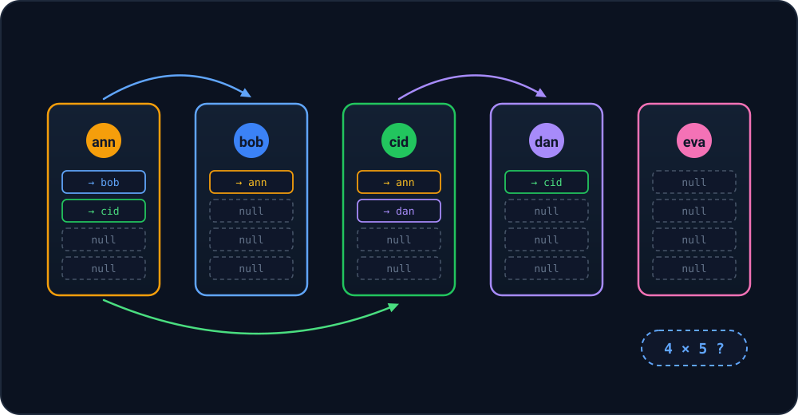

- **Объятия в семье по индексам.** Те же 5 человек,
  но каждый хранит индексы обнятых вместо ссылок —
  теперь объятия имеют смысл только вместе с массивом семьи, на который указывают индексы.
  Обнимите всех по разу.

  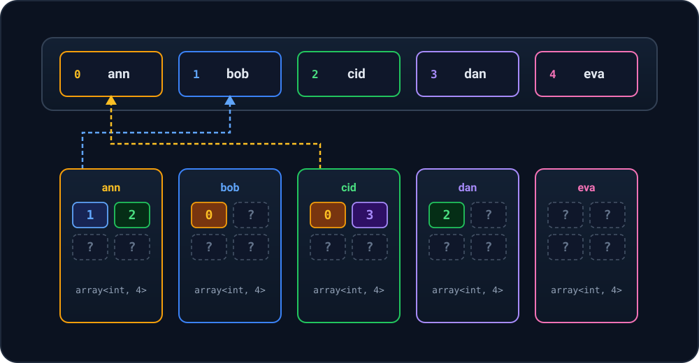

## Моделирование результатов операций

`bool` говорит только, получилось ли выполнить операцию.
Часто вызывающему коду нужно знать, *что* произошло:
какой снек куплен, сколько осталось сдачи, почему автомат отказал.
Оформите результат отдельным типом, а печать пусть реагирует на него.

В автомате со снеками есть слоты со снеком и ценой:

```csharp
using System.Diagnostics;

enum Snack
{
    Chips,
    Chocolate,
    Water,
}

static string SnackName(Snack snack)
{
    switch (snack)
    {
        case Snack.Chips:
            return "chips";
        case Snack.Chocolate:
            return "chocolate";
        case Snack.Water:
            return "water";
    }
    Debug.Assert(false); // все значения Snack обработаны выше
    return "";
}

class VendingSlot
{
    public Snack? snack;
    public int price;
}

class VendingMachine
{
    public VendingSlot[] slots =
    [
        new VendingSlot
        {
            snack = Snack.Chips,
            price = 3,
        },
        new VendingSlot
        {
            snack = null,
            price = 2,
        },
        new VendingSlot
        {
            snack = Snack.Water,
            price = 2,
        },
    ];
}
```

Покупка сообщает один из нескольких исходов.
Индекс слота и число монет приходят от покупателя,
поэтому функция сообщает о неверном выборе и оплате через результат.
Неверная цена — ошибка при настройке автомата, поэтому её проверяет `Debug.Assert`:
у каждого слота должна быть положительная цена.
Кроме того, каждый слот должен быть создан: массив ссылок сам по себе не создаёт объекты.
Успешный результат — отдельный класс,
поэтому результат не может содержать половину покупки:

```csharp
enum PurchaseStatus
{
    Bought,
    InvalidSelection,
    InvalidPayment,
    EmptySlot,
    NotEnoughCoins,
}

class BoughtSnack
{
    public Snack snack;
    public int change;
}

class Purchase
{
    public PurchaseStatus status;
    public BoughtSnack? bought; // есть ровно при status == Bought
}

static Purchase BuySnack(VendingMachine machine, int slotIndex, int coins)
{
    if (slotIndex < 0 || slotIndex >= machine.slots.Length)
    {
        return new Purchase
        {
            status = PurchaseStatus.InvalidSelection,
        };
    }
    if (coins < 0)
    {
        return new Purchase
        {
            status = PurchaseStatus.InvalidPayment,
        };
    }

    VendingSlot slot = machine.slots[slotIndex];
    Debug.Assert(slot != null);  // каждый слот должен быть создан
    Debug.Assert(slot.price > 0); // у каждого слота должна быть положительная цена
    if (slot.snack == null)
    {
        return new Purchase
        {
            status = PurchaseStatus.EmptySlot,
        };
    }
    if (coins < slot.price)
    {
        return new Purchase
        {
            status = PurchaseStatus.NotEnoughCoins,
        };
    }

    Purchase purchase = new()
    {
        status = PurchaseStatus.Bought,
        bought = new BoughtSnack
        {
            snack = slot.snack.Value,
            change = coins - slot.price,
        },
    };
    slot.snack = null; // автомат меняется только после успешной покупки
    return purchase;
}
```

Печать выбирает ветку по статусу покупки.
При успехе результат должен содержать снек и сдачу, при неудаче — не должен.
Первая проверка обнаружит неверно собранный результат.
Проверка в `default` обнаружит неизвестный статус,
при котором печать иначе просто ничего не выведет:

```csharp
static void PrintPurchase(Purchase purchase)
{
    // Данные о покупке есть тогда и только тогда, когда она успешна.
    Debug.Assert((purchase.bought != null) == (purchase.status == PurchaseStatus.Bought));
    switch (purchase.status)
    {
        case PurchaseStatus.Bought:
            Debug.Assert(purchase.bought != null); // у Bought всегда есть снек
            Console.WriteLine($"bought {SnackName(purchase.bought.snack)}, change {purchase.bought.change}");
            break;
        case PurchaseStatus.InvalidSelection:
            Console.WriteLine("no such slot");
            break;
        case PurchaseStatus.InvalidPayment:
            Console.WriteLine("the payment is invalid");
            break;
        case PurchaseStatus.EmptySlot:
            Console.WriteLine("the slot is empty");
            break;
        case PurchaseStatus.NotEnoughCoins:
            Console.WriteLine("not enough coins");
            break;
        default:
            Debug.Assert(false); // все значения PurchaseStatus обработаны выше
            break;
    }
}
```

Использование в основной функции:

```csharp
VendingMachine machine = new();

PrintPurchase(BuySnack(machine, 9, 5)); // no such slot
PrintPurchase(BuySnack(machine, 0, 5)); // bought chips, change 2
PrintPurchase(BuySnack(machine, 0, 5)); // the slot is empty
PrintPurchase(BuySnack(machine, 2, 1)); // not enough coins
```

Второй вызов — единственный, который меняет автомат.
Остальные три оставляют все слоты точно такими, какими они были.

## Планирование мутации как значения

Ещё один способ разделить обязанности — сделать изменение самостоятельным значением.
Одна функция читает текущее состояние и вычисляет изменение;
другая печатает, что сейчас произойдёт;
третья применяет изменение.
Состояние меняется в одном месте, а план можно рассмотреть до применения.

В гараже перекрашивают машины. План хранит, какую машину красят, новый цвет,
оценку времени и цену; его вычисление ничего не меняет.
Для планирования нужны существующая машина и допустимые значения текущего и нового цвета.
При применении индекс и новый цвет проверяются снова: план мог быть создан отдельно.
Проверки не дают записать недопустимый цвет, даже если план ни разу не печатали:

```csharp
enum Paint
{
    Red,
    Blue,
    Green,
}

static string PaintName(Paint paint)
{
    switch (paint)
    {
        case Paint.Red:
            return "red";
        case Paint.Blue:
            return "blue";
        case Paint.Green:
            return "green";
    }
    Debug.Assert(false); // все значения Paint обработаны выше
    return "";
}

static bool IsKnownPaint(Paint paint)
{
    switch (paint)
    {
        case Paint.Red:
        case Paint.Blue:
        case Paint.Green:
            return true;
    }
    return false;
}

class Car
{
    public string model = "";
    public Paint paint;
}

class Repaint
{
    public int carIndex;
    public Paint newPaint;
    public int hours;
    public int price;
}

static Repaint PlanRepaint(Car[] cars, int carIndex, Paint newPaint)
{
    Debug.Assert(carIndex >= 0 && carIndex < cars.Length); // план должен указывать на существующую машину
    Debug.Assert(IsKnownPaint(newPaint));                  // новый цвет должен быть допустимым значением Paint
    Car car = cars[carIndex];
    Debug.Assert(IsKnownPaint(car.paint)); // текущий цвет должен быть допустимым значением Paint
    int hours = car.paint == newPaint ? 1 : 3;
    return new Repaint
    {
        carIndex = carIndex,
        newPaint = newPaint,
        hours = hours,
        price = hours * 1000,
    };
}

static void PrintRepaint(Repaint repaint)
{
    Console.WriteLine($"car {repaint.carIndex} will be repainted {PaintName(repaint.newPaint)} in {repaint.hours} h for {repaint.price}");
}

static void ApplyRepaint(Car[] cars, Repaint repaint)
{
    Debug.Assert(repaint.carIndex >= 0 && repaint.carIndex < cars.Length); // план должен указывать на существующую машину
    Debug.Assert(IsKnownPaint(repaint.newPaint)); // новый цвет должен быть допустимым значением Paint
    cars[repaint.carIndex].paint = repaint.newPaint;
}
```

Использование в основной функции: план печатается до применения,
поэтому вывод показывает, что именно сейчас произойдёт:

```csharp
Car[] cars =
[
    new Car
    {
        model = "Supra",
        paint = Paint.Red,
    },
    new Car
    {
        model = "Civic",
        paint = Paint.Green,
    },
    new Car
    {
        model = "Miata",
        paint = Paint.Red,
    },
];

Repaint repaint = PlanRepaint(cars, 0, Paint.Blue);
PrintRepaint(repaint);
ApplyRepaint(cars, repaint);
```

План — обычное значение: его можно напечатать, сохранить или отбросить,
не трогая машины.
